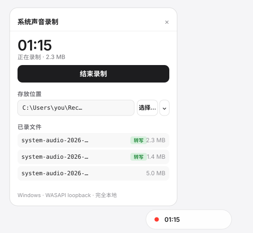

# dsh-audio-transcribe

Offline audio-to-text for [DeepSeek Harness](https://github.com/deepseek-ai/deepseek-harness),
plus a floating widget that records whatever the machine is playing.

Everything runs locally: no API key, no upload, no network at transcription time.

> **Windows x64 only.** The recorder is a bundled WASAPI loopback binary.

> **Tested against DSH Desktop 0.2.0-rc.2.** This plugin leans on two APIs the
> upstream harness currently marks experimental: bundle loading via
> `dsh.bundle.patch`, and index injection through `webserver/index-inject`.
> Both have been stable across the 0.2.0-rc line, but a future DSH release may
> change them. If the tools or the widget stop appearing after a DSH upgrade,
> check this first rather than assuming the plugin is broken — see
> [TROUBLESHOOTING.md](TROUBLESHOOTING.md).

---

## Install

### Recommended: clone and install from the checkout

```powershell
git clone https://github.com/Anchoredship/dsh-audio-transcribe
dsh plugin --profile web add file:D:\path\to\dsh-audio-transcribe
```

A `file:` install resolves straight from disk. It skips registry resolution
entirely, so there is nothing for pnpm's build-script gate to block and no
network to depend on. Use the absolute path, and keep the `file:` prefix — a
bare `.\dir` becomes a `link:` symlink, and Node then resolves the plugin's
DSH peer packages from the symlink target and fails to find them.

### Alternative: install from GitHub

```powershell
dsh plugin --profile web add github:Anchoredship/dsh-audio-transcribe
```

This fetches the sources and installs them through the registry. This plugin has
no `install` / `postinstall` / `prepare` scripts and no native dependencies, so
it should not trip pnpm's build-script policy. If pnpm does refuse with
`ERR_PNPM_IGNORED_BUILDS`, it is naming *some other* package being pulled in as a
transitive dependency — follow its prompt to allow that package, or use the
`file:` route above instead.

### Then

Restart DSH. Transcription works without any extra download because it reuses
the SenseVoice cache that DSH's own voice input already prepared — if that cache
is absent, run `audio_model_download` once.

---

## What it looks like

The expanded widget, with a recording in progress and three past recordings
(two already transcribed):

<p align="center">
  <a href="docs/widget.svg"></a>
</p>

## What it gives you

### Three model tools

| Tool | Purpose |
|---|---|
| `audio_transcribe` | Turn a WAV file into text with the local SenseVoice model |
| `audio_model` | Report where the model lives and whether it is intact |
| `audio_model_download` | Fetch the model (~230 MB) into a directory you choose |

### A recording widget

A draggable pill in the bottom-right of the Web/Desktop GUI:

- **Start / stop** capturing system playback (not the microphone)
- Live timer, and it keeps counting while the panel is closed
- **View and change** where recordings are stored
- Lists recent recordings, and marks the ones that already have a transcript
- **Auto-transcribes** each recording to a `.txt` beside the WAV

---

## Why recording needs a host process

A browser cannot capture what the machine is playing. The widget is therefore a
remote control: the buttons call host routes under `/dsh-audio`, and the host
spawns `bin/LoopbackCap.exe` (WASAPI loopback, via NAudio) to do the capture.

```
widget (browser)  ──HTTP──▶  host routes  ──spawn──▶  LoopbackCap.exe
                                                            │
                                                     <dir>/system-audio-*.wav
                                                            │
                                                   SenseVoice ──▶ .txt
```

No virtual audio cable is required: WASAPI loopback reads the output device
directly, without changing the default device or installing a driver.

---

## Storage

| | |
|---|---|
| Default | `<dshHome>/audio-transcribe/recordings` |
| Change it | **选择…** button (opens the OS folder chooser), or `POST /dsh-audio/dir.json` |
| Persisted in | `<dshHome>/audio-transcribe/config.json` — survives restarts |
| Layout | one timestamped folder per recording (toggleable in the widget) |

### Layout

With **每次录音新建独立文件夹** enabled (the default), every take gets its own
folder so the audio and its transcript stay together:

```
<recordDir>/
└── 2026-10-21_13-02-11/
    ├── system-audio.wav
    └── system-audio.txt
```

Turn the option off and recordings land flat in `<recordDir>`, with the timestamp
moved into the filename (`system-audio-2026-10-21_13-02-11.wav`) so they still do
not collide.

The list reads **both** layouts, so recordings made before grouping was
introduced keep showing up.

### Why a config file, not the settings service

`settings.mutate()` only persists volatile fields of an active *profile entry*.
This plugin is a bundle without its own entry id, so a write through that API is
accepted and then silently dropped — which is why an early version reset the
chosen directory on every restart. The plugin therefore owns a small JSON file
and writes it atomically (temp file + rename).

Changing the directory uses DSH's own directory-picker seam rather than a
hand-rolled text box. That seam exposes a **capability**, not one fixed method
set, because backends differ in interaction shape:

```js
const cap = ctx.directoryPicker.capability()
// { kind: 'native', pick(signal) }                 → OS folder chooser
// { kind: 'browse', list(path?), createDirectory } → in-app tree
```

So the plugin asks the host which kind it has (`GET /dsh-audio/picker.json`) and
renders accordingly:

| Capability | Widget behaviour |
|---|---|
| `native` | **选择…** opens the OS chooser; manual paste stays as a secondary option |
| `browse` | no tree is drawn; the widget says so and offers manual entry |
| none | the picking button is hidden, manual entry only |

The last case is deliberate: a composition with no picker backend must hide the
affordance rather than fail.

### Which kind does this host get?

`dsh-base` composes `dsh-host-directory-picker-auto`, which resolves once at
boot:

```js
if (bindHost !== '127.0.0.1') return 'browse'   // remote browsers cannot reach an OS dialog
if (ssh) return 'browse'                        // the chooser would open on an unattended server
if (platform === 'darwin' || platform === 'win32') return 'native'
```

On this machine — Windows, loopback bind, launched locally — the answer is
**`native`**, so the widget opens the real folder chooser.

A picked directory is validated as writable before it is accepted, so a bad
choice fails immediately instead of at record time.

---

## Model

By default it reuses the cache that DSH's own speech input already prepared:

```
<dshHome>/speech-to-text/sensevoice/models
├── sensevoice-onnx/model.int8.onnx
├── sensevoice-onnx/tokens.txt
└── silero/silero_vad.onnx
```

If that cache is absent, `audio_model_download` can fetch the pinned revision
(verified by size and SHA-256) into the plugin's own directory. A fresh download
never writes into the shared cache.

Two layouts are supported when locating the files: the layered one above, and a
flat directory holding all three files.

### Decode modes

`auto` (default) picks per file:

- ≤ 30 s → `whole` (one pass, fastest)
- \> 30 s with ≥ 15 % silence → `segment` (Silero VAD splits the speech)
- \> 30 s otherwise → `whole` up to 120 s, then `segment`

`segment` output carries `[12.3s]` timestamps and handles long or pause-heavy
audio better. Force either with `audio_transcribe`'s `mode` argument.

---

## Requirements

| | |
|---|---|
| Platform | Windows x64 |
| Runtime | reuses the sherpa-onnx build shipped with DSH Desktop 0.2.x |
| .NET | built against the in-box .NET Framework 4.x |
| Recorder | `bin/LoopbackCap.exe` + NAudio, bundled (424 KB) |

Nothing is installed system-wide.

---

## HTTP surface

All routes are host-owned and mounted under `/dsh-audio`:

| Route | Method | Purpose |
|---|---|---|
| `/dsh-audio/status.json` | GET | Recording state, storage dir, recent files |
| `/dsh-audio/start.json` | POST | Begin recording (`{ maxSeconds }`, capped at 7200) |
| `/dsh-audio/stop.json` | POST | Stop and finalise the WAV |
| `/dsh-audio/dir.json` | GET/POST | Read or change the storage directory |
| `/dsh-audio/settings.json` | GET/POST | Per-recording-folder toggle |
| `/dsh-audio/picker.json` | GET | Which directory-picker capability the host has |
| `/dsh-audio/pick.json` | POST | Open the OS chooser and adopt the result |
| `/dsh-audio/ui.js` | GET | The widget script |

Every route passes a trust fence before it runs: a non-loopback `Host`, a
cross-site `Sec-Fetch-Site`, or a mismatched `Origin` is answered with 403. The
mutating routes accept only the method listed above; anything else gets 405.
Without that fence, any page the user visits could start a recording or
enumerate their recordings.

### How the widget gets injected

On the desktop shell, `index.html` is served from the packaged dist and never
passes through `tapIndex`, so the only working channel is the structured row
emitted on `webserver/index-inject`:

```js
root.on('webserver/index-inject', (table) => {
  table.push({ kind: 'script', placement: 'body', text: INJECT_TEXT })
})
```

It must be an **inline `script` row**, never `script-src`: a failing `script-src`
rejects `__DSH_BOOT_READY__` and the whole app fails to start. The injected
snippet creates the script tag itself and swallows `onerror`, so a missing route
degrades to "no widget" instead of a broken app.

---

## Stopping cleanly

`LoopbackCap.exe` watches for `<file>.stop` and finalises the WAV itself. Killing
the process instead leaves the RIFF header unwritten, which every decoder reads
as **0 seconds** — a 250 KB file that transcribes to nothing.

Two details make that reliable:

**The read loop runs on its own thread.** In WASAPI loopback, a silent output
device delivers no data at all, and `Read` blocks until data arrives. A
single-threaded read-then-check loop therefore never reaches the stop-file check,
so the capture ran until the plugin gave up and killed it — producing a
truncated file. The reader now owns the buffer exclusively while the main thread
only polls the stop file.

**Silence is a normal outcome, not a failure.** Exit code 3 (no data) and 4
(captured but silent) both produce a valid WAV with no audible content. The
widget labels those takes **无声** rather than letting you open a file and
conclude the recording is broken, and they are skipped by auto-transcription.

---

## License

[MIT](LICENSE). The NAudio assemblies bundled in `bin/` are also MIT
(see LICENSE for attribution). The SenseVoice model is downloaded at runtime and
is not distributed by this repository.

Contributions are welcome — see [CONTRIBUTING.md](CONTRIBUTING.md), and check
[TROUBLESHOOTING.md](TROUBLESHOOTING.md) before filing an issue.

---

## Exit behaviour

The widget reports failures inline rather than silently:

| Situation | What you see |
|---|---|
| Nothing playing | Recording succeeds with a near-silent WAV; transcript is empty |
| Wrong output device | Empty transcript — check the default playback device |
| Recorder binary missing | Button disabled, `采集程序缺失` |
| Model missing | Transcription error naming the files and the fix |

---

## Development notes

Host modules:

| File | Role |
|---|---|
| `src/index.js` | Config, model resolution, the three tools, widget mounting |
| `src/recorder.js` | Child-process lifecycle, status, file listing |
| `src/ui-routes.js` | HTTP routes and the index injection row |
| `assets/audio-ui.js` | The browser widget (plain script, no build step) |

`audio_transcribe` and the widget share `transcribeFile()`, so the same audio
produces the same text either way.

Rebuild the recorder after editing `LoopbackCap.cs`:

```powershell
$csc = "C:\Windows\Microsoft.NET\Framework64\v4.0.30319\csc.exe"
$ns  = "C:\Windows\Microsoft.NET\assembly\GAC_MSIL\netstandard\v4.0_2.0.0.0__cc7b13ffcd2ddd51\netstandard.dll"
& $csc /nologo /target:exe /out:"bin\LoopbackCap.exe" `
  /r:"bin\NAudio.Core.dll" /r:"bin\NAudio.Wasapi.dll" /r:"bin\NAudio.WinMM.dll" /r:"$ns" `
  "src\LoopbackCap.cs"
```

`bin/LoopbackCap.exe.config` must keep `loadFromRemoteSources enabled="true"`,
or .NET refuses to load NAudio from a non-GAC path.
